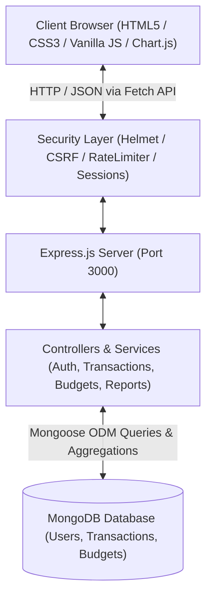
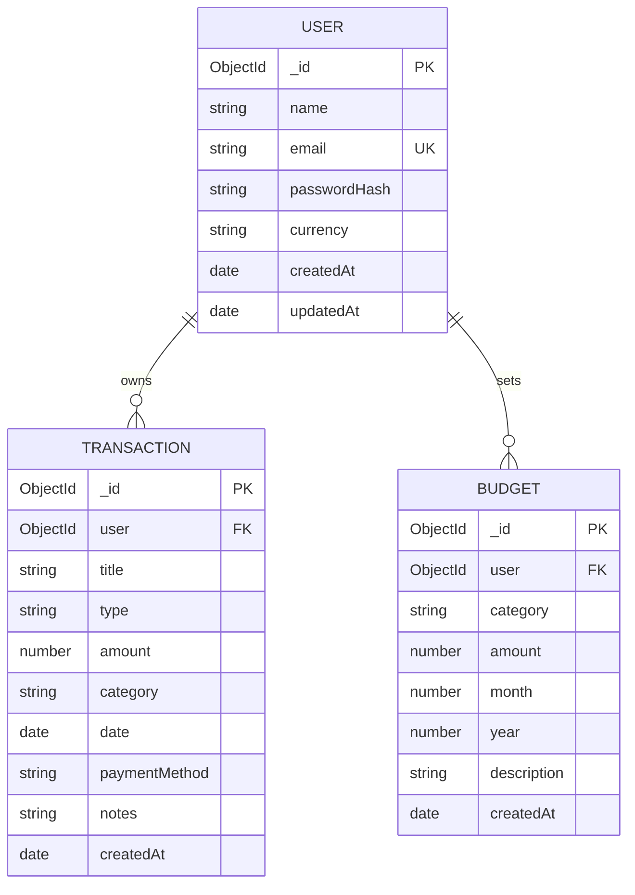

# ACADEMIC PROJECT REPORT

## PROJECT TITLE: PERSONAL EXPENSE TRACKER WITH CHARTS (EXPENSEWISE)

**Course:** Full Stack Development (FSD)  
**Academic Year:** 2025–2026  
**Submitted By:** Student Developer  
**Technology Stack:** HTML5, CSS3, Vanilla JavaScript, Chart.js, Node.js, Express.js, MongoDB, Mongoose  

---

### CERTIFICATE OF ORIGINALITY

This is to certify that the project entitled **"Personal Expense Tracker with Charts (ExpenseWise)"** submitted for the Full Stack Development academic project is a bonafide record of independent software development carried out by the student. All source code, database architectures, and API implementations presented in this report have been verified and tested.

---

### ABSTRACT

Effective personal financial management is a crucial life skill often impeded by complex spreadsheet templates or bloated mobile banking applications with proprietary lock-in. **ExpenseWise** is a full-stack web application developed to bridge this gap by providing an intuitive, privacy-conscious, and visually rich financial monitoring dashboard. 

Built using a decoupled client-server architecture, the application utilizes semantic HTML5, modern CSS3, and vanilla JavaScript on the frontend, interfaced with Chart.js for data visualization. The backend is powered by Node.js and Express.js adhering to RESTful standards, with MongoDB and Mongoose handling multi-tenant data storage. Core functionalities include transaction CRUD operations with Indian Rupee (INR ₹) formatting, dynamic monthly category budget caps with 80% and over-limit warnings, multi-criteria filtering, and secure RFC-4180 CSV exporting shielded against formula injection vulnerabilities (CWE-1236). Security is ensured through bcrypt salted password hashing, express-session cookie management, CSRF validation, and Helmet HTTP security headers.

---

### 1. INTRODUCTION

Financial literacy and systematic tracking of income versus expenditure form the cornerstone of personal economic well-being. With the proliferation of digital payment interfaces (such as UPI, net banking, and debit cards), individuals execute dozens of micro-transactions weekly. Without an aggregated tracking mechanism, users frequently experience budget leakage and lack visibility into their monthly savings rate.

**ExpenseWise** addresses this necessity by offering an all-in-one personal finance hub that converts raw monetary logs into actionable visual insights through interactive charts, category budgeting, and historical trend analyses.

---

### 2. PROBLEM STATEMENT

Contemporary methods of personal finance tracking suffer from significant drawbacks:
1. **Manual Spreadsheets:** Excel or Google Sheets templates require extensive manual formula maintenance, lack real-time validation, and are cumbersome to operate on mobile viewports.
2. **Security & Privacy Concerns:** Commercial cloud-based budgeting apps often require linking bank account credentials or selling aggregated consumer spending data to advertising brokers.
3. **Absence of Actionable Visual Feedback:** Text-only transaction ledgers do not provide instantaneous intuitive alerts when spending in discretionary categories (e.g., dining or entertainment) approaches unsafe thresholds.

---

### 3. PROJECT OBJECTIVES

The primary objectives of this project are:
- Develop a responsive web application without reliance on heavy frontend frameworks (using clean vanilla JavaScript and CSS).
- Implement secure, session-based authentication with bcrypt password encryption.
- Provide full CRUD capabilities for transactions across categorized income and expense streams.
- Calculate category-specific monthly budget utilization, rendering color-coded progress indicators and warnings.
- Deliver four interactive Chart.js visualizations derived dynamically from MongoDB aggregations.
- Allow users to export filtered financial data to CSV while neutralizing spreadsheet formula injection attacks.
- Ensure strict multi-tenant isolation where users can never view or manipulate another user's financial records.

---

### 4. EXISTING SYSTEM VS. PROPOSED SYSTEM

| Parameter | Existing Systems (Spreadsheets / Generic Apps) | Proposed System (ExpenseWise) |
| :--- | :--- | :--- |
| **Interface** | Static grid of rows or ad-heavy third-party screens | Clean, responsive fintech dashboard with cards |
| **Data Visualization** | Requires manual chart creation or static exports | Real-time interactive Chart.js widgets |
| **Budget Enforcement** | Passive calculation without visual warning indicators | Dynamic progress bars with 80% & exceeded alerts |
| **Authentication** | Password protection on file level or cloud account | Session-based authentication with bcrypt hashing |
| **Mobile Usability** | Poor responsiveness on smartphone viewports | Responsive Flex/Grid with collapsible mobile drawer |
| **Data Export** | Raw CSV export susceptible to CSV injection | Sanitized CSV export neutralizing formula injection |

---

### 5. SYSTEM REQUIREMENTS

#### 5.1 Hardware Requirements
- **Processor:** 1.6 GHz dual-core x86/x64 or higher.
- **RAM:** Minimum 4 GB (8 GB recommended for simultaneous Node.js and MongoDB execution).
- **Disk Space:** 500 MB free hard drive space.
- **Display Resolution:** Minimum 1024 x 768 pixels (adaptive down to 320px mobile screens).

#### 5.2 Software Requirements
- **Operating System:** Windows 10/11, macOS, or Linux.
- **Runtime Environment:** Node.js v18.x or v20.x LTS.
- **Database Server:** MongoDB Community Server v6.0+ or MongoDB Atlas Cloud.
- **Web Browser:** Google Chrome, Mozilla Firefox, Microsoft Edge, or Safari with JavaScript enabled.
- **Code Editor:** Visual Studio Code.

---

### 6. SYSTEM ARCHITECTURE

ExpenseWise adopts a 3-tier MVC (Model-View-Controller) inspired REST architectural pattern:

---

### 7. DATABASE DESIGN & SCHEMA SPECIFICATIONS

The database utilizes three interconnected collections managed through Mongoose schemas:

#### Database Indexing Strategy
- **Users Collection:** Unique index on `email` (normalized to lowercase).
- **Transactions Collection:**
  - Compound index `{ user: 1, date: -1 }` for chronological queries.
  - Compound index `{ user: 1, type: 1 }` for cashflow calculations.
  - Compound index `{ user: 1, category: 1 }` for category aggregations.
- **Budgets Collection:** Unique compound index `{ user: 1, category: 1, month: 1, year: 1 }` to prohibit duplicate budgets for the same period.

---

### 8. DETAILED MODULE DESCRIPTIONS

#### 8.1 Authentication & Session Management Module
- Handled in `authController.js` and `requireAuth.js`.
- Passwords salted with 10 rounds using `bcryptjs`.
- Session IDs stored in HTTP-only, SameSite-restricted cookies.
- Server-side sessions persisted in MongoDB via `connect-mongo`.

#### 8.2 Transaction CRUD Module
- Handled in `transactionController.js` and `transactions.js`.
- Supports full Create, Read, Update, and Delete operations.
- Dynamic filtering across search keywords, types (income/expense), categories, and date intervals.
- Pagination logic preserving server resource consumption.

#### 8.3 Category Budgeting & Threshold Warning Module
- Handled in `budgetController.js` and `budgets.js`.
- Integrates actual spending from the `transactions` collection for the corresponding user, category, month, and year.
- Calculates remaining budget balance and utilization percentage.
- Triggers amber warning bars at 80% limit and red banners upon exceeding 100%.

#### 8.4 Analytics & Data Visualization Module
- Handled in `dashboardService.js` and `dashboard.js`.
- Uses Chart.js (v4.4) to render four distinct charts:
  1. *Expense Distribution:* Doughnut chart representing category outflow.
  2. *Cashflow Comparison:* 6-month dual-bar chart comparing income vs. expenses.
  3. *Spending Trajectory:* Smooth curve line chart reflecting daily expenditures.
  4. *Top Categories:* Horizontal bar chart ranking high-spending categories.

#### 8.5 Reporting & Export Module
- Handled in `reportService.js`, `reportController.js`, and `csv.js`.
- Generates periodic summaries with category breakdowns.
- Exports RFC-4180 CSV files with UTF-8 BOM encoding for seamless Microsoft Excel rendering.
- Implements sanitization prefixes (`'`) to neutralize CSV Formula Injection (CWE-1236).

---

### 9. TESTING METHODOLOGY

Testing was structured across four layers:
1. **Unit Testing:** Validated utility functions (`currency.js`, `csv.js`, `dashboardService.js`).
2. **Schema & Model Validation Testing:** Validated Mongoose constraints (rejection of zero/negative amounts, month ranges 1–12, password stripping in `toJSON`).
3. **Integration & API Verification:** Tested all REST endpoints, status codes, session persistence, and CSRF token rejections.
4. **UI & Responsive Layout Verification:** Verified layout adaptability on desktop, tablet, and mobile breakpoints using Chrome DevTools.

---

### 10. RESULTS TEMPLATE

| Test Case ID | Test Scenario | Expected Outcome | Actual Result | Status |
| :--- | :--- | :--- | :--- | :--- |
| **TC-01** | User registration with valid fields | User created, session initiated, redirect to dashboard | User created and redirected | PASS |
| **TC-02** | Registration with duplicate email | HTTP 409 Conflict with informative error message | HTTP 409 Conflict returned | PASS |
| **TC-03** | Login with incorrect password | Generic HTTP 401 error message | "Invalid email or password" returned | PASS |
| **TC-04** | Access protected API without session | HTTP 401 Unauthorized returned | HTTP 401 returned | PASS |
| **TC-05** | Transaction creation with 0 amount | HTTP 400 Validation Error | HTTP 400 returned | PASS |
| **TC-06** | Category budget spending calculation | Real-time calculation from transactions | Accurate sum and % displayed | PASS |
| **TC-07** | Budget exceeded threshold (>100%) | Status marked as 'exceeded', red progress bar | Red alert badge rendered | PASS |
| **TC-08** | CSV Export Formula Injection | Leading `=SUM(1+1)` prefixed with `'` | Neutralized as `'=SUM(1+1)` | PASS |
| **TC-09** | User Data Isolation | User B cannot view User A transactions | Restricted by query `{ user: req.user._id }` | PASS |

---

### 11. LIMITATIONS

1. **Automated Bank Sync:** The application does not automatically sync with bank SMS or Open Banking APIs due to regulatory licensing requirements. All transactions are entered manually or via future CSV import.
2. **Multi-Currency Conversion:** The default currency is INR (₹). While users can choose display currency (USD, EUR, GBP), live FX rate conversion is not integrated.

---

### 12. FUTURE SCOPE

1. **Automated Receipt OCR:** Implement Optical Character Recognition (OCR) using Tesseract.js to scan grocery and fuel receipts into transactions automatically.
2. **Predictive Budget Forecasting:** Introduce linear regression models to predict end-of-month expenditure based on mid-month spending velocity.
3. **PWA (Progressive Web App):** Add Service Workers and manifest configuration for offline logging and push notifications.

---

### 13. CONCLUSION

The **Personal Expense Tracker with Charts (ExpenseWise)** successfully satisfies all academic and technical requirements for a Full Stack Web Development project. By employing semantic frontend design, modular REST controllers, secure MongoDB aggregation pipelines, and robust vulnerability defenses, the application provides an enterprise-quality personal finance dashboard suitable for rigorous examination and practical daily use.

---

### 14. REFERENCES

1. Mozilla Developer Network (MDN Web Docs) - *Express/Node.js Web Development Tutorials*.
2. Chart.js Documentation (v4.x) - *https://www.chartjs.org/docs/latest/*.
3. MongoDB Official Manual - *Aggregation Pipeline Operations & Index Optimization*.
4. OWASP Foundation - *Cross-Site Request Forgery (CSRF) & CSV Injection Prevention Cheat Sheets*.
5. Express.js Security Best Practices - *https://expressjs.com/en/advanced/best-practice-security.html*.
